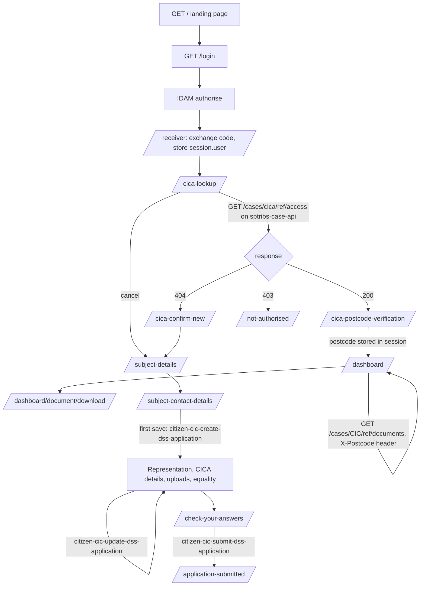

# Citizen journey

This page describes how `sptribs-frontend` moves a citizen through the service, which back-end calls each part makes, and how sessions, Welsh and document uploads work.

## Overview

## Sign-in

The OIDC middleware (`src/main/modules/oidc/index.ts`) adds three routes:

| Route | Behaviour |
|---|---|
| `GET /login` | Redirects to IDAM `authorize` with scopes `openid profile roles` and the callback `/receiver` |
| `GET /receiver` | Exchanges the authorisation code for tokens, decodes the ID token into `session.user`, then redirects to `/cica-lookup` |
| `GET /logout` | Destroys the session and redirects to the IDAM end-session URL |

Every other route needs `session.user`, apart from the pages listed in `signInNotRequired()` (`src/main/steps/url-utils.ts`) and the public routes in `src/main/routes/authless/`. A signed-in request gets a `CaseApi` (`req.locals.api`) and a `CaseDocumentManagementClient` (`req.locals.documentApi`) built from the user's token.

Calls to CCD, `sptribs-case-api` and CDAM carry two tokens: the user's IDAM access token and a service-to-service (S2S) token. The S2S token is leased from the service auth provider (`POST {services.authProvider.url}/lease` with a TOTP one-time password) when the app starts and refreshed every hour (`src/main/app/auth/service/get-service-auth-token.ts`). The app leases its token as `sptribs_case_api` (`services.authProvider.microservice`).

## Landing page

`/` (`src/main/routes/authless/controllers/landing.ts`) renders the start page, or redirects a signed-in user to `/subject-details`. It accepts two optional query parameters:

- `edgecaseType`: checked against `queryParamsforApp.query` in config (`CIC` in `config/default.yaml`). A match is stored in `req.session['edgecaseType']`; any other value renders the error page. The pipeline smoke stages open the app at `/?edgecaseType=CIC`.
- `lang`: `en` or `cy`, selecting the landing page's own content.

`/cic-update` redirects to the update-case app at `services.dssUpdate.url`.

## Finding an existing case

| Step | Controller | Behaviour |
|---|---|---|
| `/cica-lookup` | `src/main/steps/cica-lookup/post.ts` | Calls `GET /cases/cica/{ccdReference}/access` on `sptribs-case-api`. 200 sets `session.userCase.id` and goes to postcode verification. 404 goes to `/cica-confirm-new`. 403 goes to `/not-authorised`. 400 returns to the lookup with an error; any other failure goes to `/cica-confirm-new`. Cancel goes to `/subject-details` |
| `/cica-confirm-new` | `src/main/steps/cica-confirm-new/post.ts` | Confirms the citizen wants a new application, then goes to `/subject-details` |
| `/cica-postcode-verification` | `src/main/steps/cica-postcode-verification/post.ts` | Stores the postcode in `session.validatedPostcode` and redirects to `/dashboard`. The postcode is checked by the back end, not here |
| `/dashboard` | `src/main/steps/dashboard/get.ts` | Needs both the case ID and the postcode in the session, and otherwise redirects to the page that collects the missing one. Calls `GET /cases/CIC/{ccdReference}/documents` with the postcode in an `X-Postcode` header. A 401 goes to `/postcode-error`, a 403 to `/not-authorised`, and any other failure back to `/cica-lookup` |
| `/dashboard/document/download?documentId=…` | `src/main/steps/dashboard/download.ts` | Calls `GET /cases/CIC/{ccdReference}/documents/{documentId}/download` with the same header and streams the file to the browser |

`sptribs-case-api` groups the dashboard documents. The page shows three groups: `latestCaseBundleDocuments`, `contactPartiesDocuments` and `orderAndDecisionDocuments`.

The lookup, postcode and dashboard handlers log structured telemetry events through `src/main/steps/dashboard-telemetry.ts`, for example `cica_lookup_succeeded` or `dashboard_load_failed`. Each event carries an attempt ID, the step, the outcome, the next step and timings, and a journey ID held in the session links the events from one visit. `classifyDashboardError()` sorts back-end failures into timeout, connection error, rate limiting, unauthorised, 4xx and 5xx.

## New application

### Steps and routing

The application pages are defined in `edgecaseSequence` (`src/main/steps/edge-case/edgecaseSequence.ts`). The main path is:

1. `/subject-details`
2. `/subject-contact-details`
3. `/representation`
4. `/representation-qualified`
5. `/representative-details`
6. `/cica-reference-number`
7. `/cica-decision-date`
8. `/upload-appeal-form`
9. `/upload-supporting-documents`
10. `/upload-other-information`
11. `/equality`
12. `/check-your-answers`
13. `/application-submitted`

Each step is a directory under `src/main/steps/edge-case/` holding `content.ts`, `template.njk` and, where the default behaviour is not enough, its own GET or POST controller. `src/main/routes.ts` registers a GET route for every step and a POST route for every step with a form. It uses the step's own controller if the directory has one, and the generic `GetController` or `PostController` otherwise.

Each step's `getNextStep(data)` returns the next URL. `getNextIncompleteStepUrl()` in `src/main/steps/index.ts` walks the sequence and checks each form's `isComplete()`; steps marked `excludeFromContinueApplication` are skipped when a citizen resumes.

The equality step (`/equality`) hands the citizen to the Protected Characteristics Questionnaire (PCQ) service when `services.equalityAndDiversity.enabled` is true, the subject is 16 or over, no PCQ ID is held yet and PCQ's `/health` reports `UP`. PCQ returns them to `/check-your-answers`. Otherwise the step goes straight to check your answers.

### Creating, updating and submitting the case

`PostController.getEventName()` picks the CCD event from the page being posted:

| Page | Event | Call |
|---|---|---|
| `/subject-contact-details`, when `session.userCase.id` is empty | `citizen-cic-create-dss-application` | `CaseApi.createCase()`: `GET /case-types/CriminalInjuriesCompensation/event-triggers/{event}` for a token, then `POST /case-types/CriminalInjuriesCompensation/cases` |
| `/contact-details`, `/cica-reference-number`, `/cica-decision-date` and the `/represent…` pages | `citizen-cic-update-dss-application` | `getEventTrigger()` then `triggerEvent()`: `POST /cases/{caseId}/events` |
| `/check-your-answers` | `citizen-cic-submit-dss-application` | Same, from `checkYourAnswerPostController.ts`, then redirect to `/application-submitted` |

These calls go to CCD data store (`services.ccd.url`) with an `experimental: true` header. Points to keep in mind when changing them:

- Every event needs a fresh event token from the event-trigger endpoint. Tokens are single-use.
- Case creation is not idempotent: two create calls make two cases.
- `triggerEvent()` retries up to three times on 502 and 504. A 409 raises a version-conflict error, and other errors are not retried.
- Field names are mapped with `toApiFormat()` on the way out and `fromApiFormat()` on the way back (`src/main/app/case/`).
- "Save as draft" (`saveAsDraft` in the form body) drops the required-field errors and saves what has been entered.

The case API handles the events. `citizen-cic-create-dss-application` puts the case in `DSS_Draft`, and `citizen-cic-submit-dss-application` moves it to `DSS_Submitted`. A scheduled task in `sptribs-case-api` moves drafts not modified for 30 days to `DSS_Expired`. See the [sptribs-case-api repository](https://github.com/hmcts/sptribs-case-api) for the event definitions.

### Address lookup

The address pages (`/address/lookup`, `/address/select`, `/address/manual`) call the Ordnance Survey Places API (`services.postcodeLookup.url`) through `getAddressesFromPostcode()` in `src/main/app/postcode/postcode-lookup-api.ts`, passing `services.postcodeLookup.token` as the `key` query parameter.

## Document upload

Each upload page has its own `UploadController` subclass (`src/main/app/controller/UploadController.ts`), which maps the page to a case field and a document limit:

| Page | Case field | Limit key |
|---|---|---|
| `/upload-appeal-form` | `caseDocuments` | `documentUpload.validation.totaldocuments` (5) |
| `/upload-supporting-documents` | `supportingCaseDocuments` | `documentUpload.validation.totalSupportingDocuments` (5) |
| `/upload-other-information` | `otherCaseInformation` | `documentUpload.validation.totalOtherInformation` (20) |

`documentUpload.validation.sizeInBytes` (104857600, 100 MB) is the per-file size limit. Accepted types are PDF, Word (`.doc`, `.docx`), Excel, RTF, plain text, PNG and JPEG.

Uploads are posted to the app, which forwards them from the server:

1. `express-fileupload` (`src/main/modules/fileupload/index.ts`) parses the multipart body into `req.files`.
2. `CaseDocumentManagementClient.create()` (`src/main/app/document/CaseDocumentManagementClient.ts`) posts the file to CDAM `POST {services.cdam.url}/cases/documents` with `caseTypeId`, `jurisdictionId` and `classification: PUBLIC`, the user and S2S tokens and a `user-id` header.
3. The document returned by CDAM is kept in the session under the page's property name, and the next CCD event sends it as a document link.

Removing a document calls `DELETE /cases/documents/{id}` on CDAM.

## Sessions

Sessions use `express-session` (`src/main/modules/session/index.ts`):

| Setting | Value |
|---|---|
| Cookie name | `sptribs-frontend-session` |
| Lifetime | 21 minutes, rolling (renewed on every request) |
| Flags | `httpOnly`; `secure` outside development mode |
| Store | Redis (`connect-redis`, TLS, 15-second connect timeout) when `session.redis.host` is set; otherwise a file store in `/tmp` |

The session holds the signed-in user, the case being worked on (`session.userCase`), uploaded document references, the validated postcode, the language choice and the telemetry journey ID. When the session expires the citizen is signed out and unsaved form entries are lost. `/keep-alive` lets the page extend the session, and `/timed-out` is shown after expiry.

## Welsh

The app supports English and Welsh. `LanguageToggle` (`src/main/modules/i18n/index.ts`) reads `?lng=cy` or `?lng=en` on any GET request and stores the choice in `req.session['lang']`, where it stays until changed. Unsupported values are ignored, and the default is English.

Page text lives in a `translation.json` file per page under `src/main/resources/<page>/`, with `en` and `cy` keys. New content needs both.

## Related documentation

- [Configuration](configuration.md)
- [Running and testing](running-and-testing.md)
- [sptribs-case-api](https://github.com/hmcts/sptribs-case-api): the case type, the citizen events and the `/cases/cica/...` endpoints
- [sptribs-dss-update-case-web](https://github.com/hmcts/sptribs-dss-update-case-web): adding documents to an existing case
